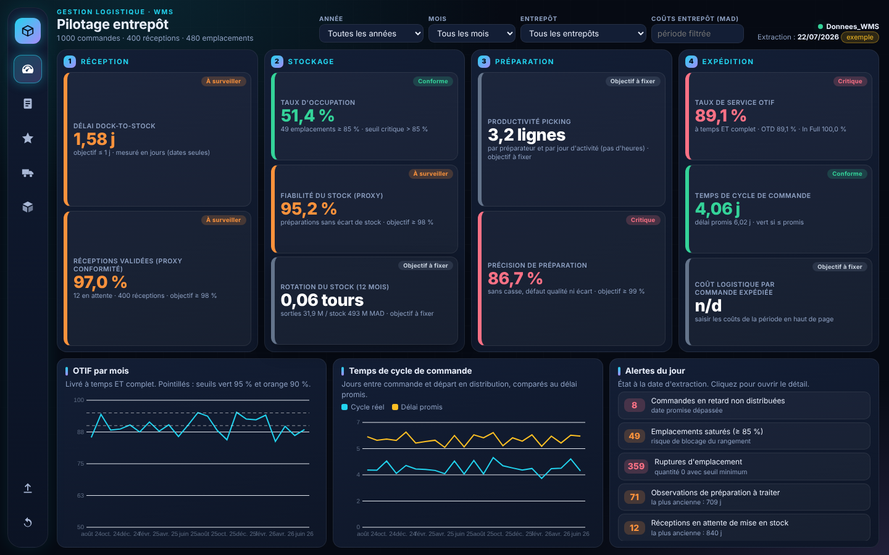
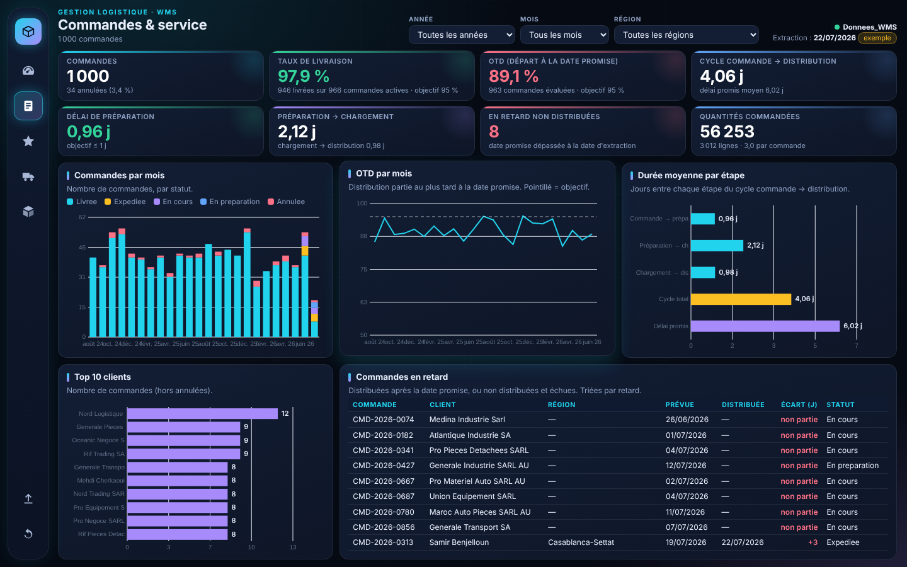
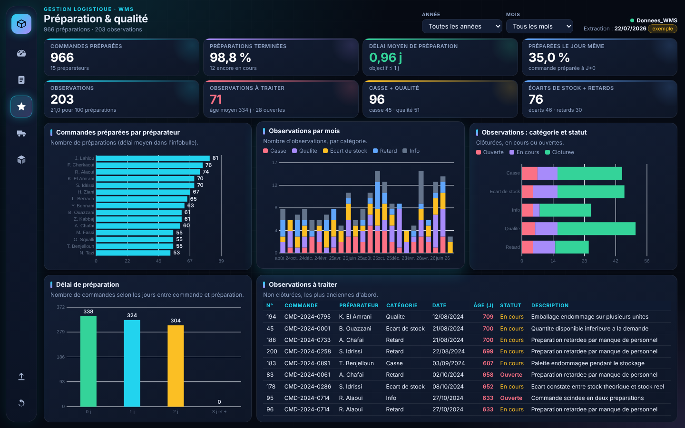
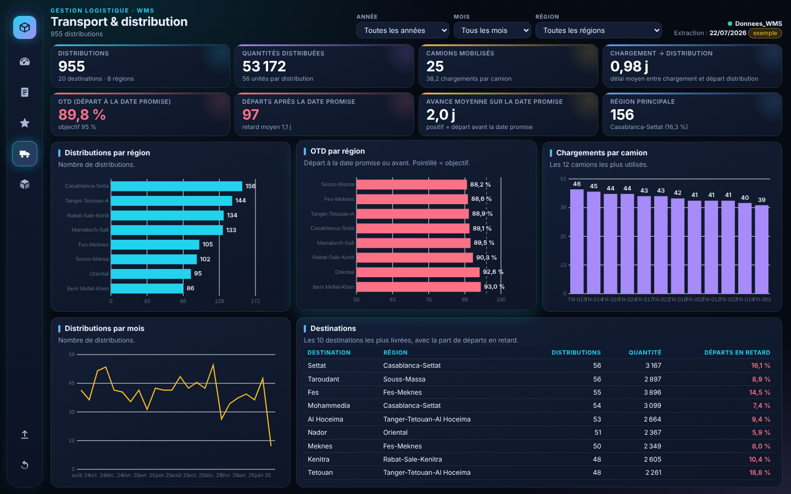

# 📊 WMS & Supply Chain Analytics — Dashboard & Automation

Ce projet propose une solution clé en main d'extraction, traitement et visualisation de données WMS (Warehouse Management System) pour le pilotage de la performance logistique (OTIF, qualité de préparation, rotation des stocks, distribution).

## 🚀 Fonctionnalités & KPIs traités

- **Service Client & Commandes :** Suivi du taux de service, analyse OTIF et gestion des reliquats.
- **Préparation & Qualité :** Contrôle des erreurs de picking, productivité des préparateurs et réassort des emplacements.
- **Stock & Entrepôt :** Analyse de la couverture de stock, suivi du remplissage des bacs/alvéoles.
- **Transport & Distribution :** Suivi du remplissage camion, taux d'expédition à temps et délais de livraison par région.

## 🛠️ Stack Technique

- **Python :** Traitement de données et génération de dashboards interactifs (`generer_logistique.py`).
- **Data Stores / Excel :** Tables de modélisation WMS (Commandes, Lignes, Articles, Bacs, Camions, Restocking).
- **HTML/CSS/JS :** Restitution sous forme de tableau de bord web interactif.

## 📸 Aperçu des Tableaux de Bord

| Pilotage Entrepôt | Commandes & Service |
| :---: | :---: |
|  |  |

| Préparation & Qualité | Transport & Distribution |
| :---: | :---: |
|  |  

### Par Kamal KHATIM
